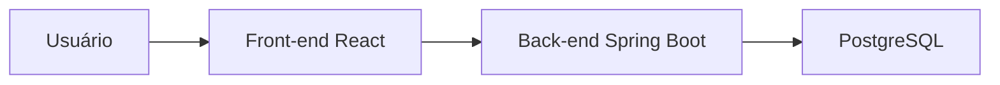
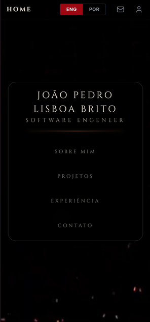
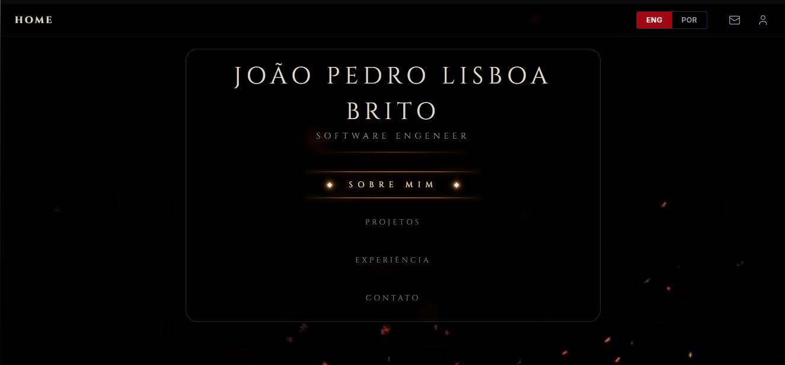
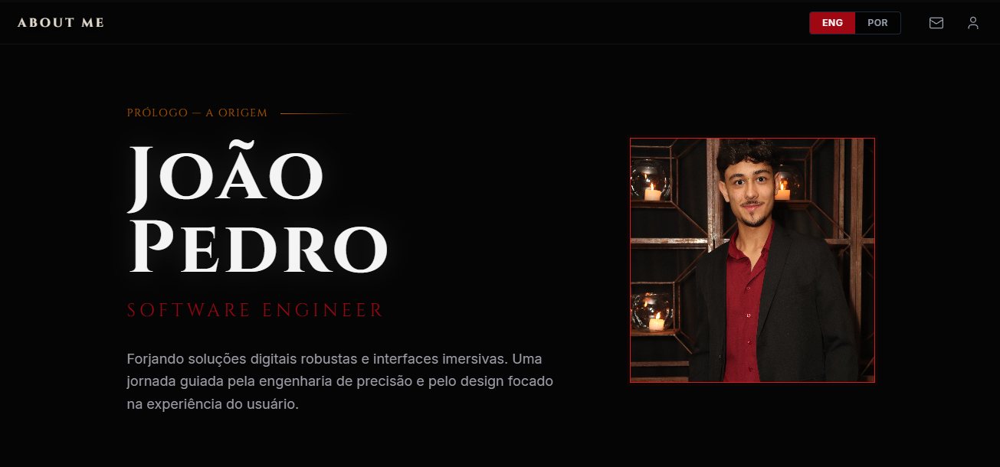

# 🏷️ Portfolio Profissional - João Pedro 👨‍💻

> [!NOTE]
> Portfolio pessoal e profissional com foco em destacar minha trajetória, stack tecnológica, projetos e oportunidades de colaboração.

<table>
  <tr>
    <td width="800px">
      <div align="justify">
        Este <b>README.md</b> apresenta o meu portfólio profissional, com uma visão geral da minha formação, experiência e projetos desenvolvidos em <b>React</b>, <b>Java</b> e <b>Spring Boot</b>. A proposta da aplicação é reunir de forma organizada minhas informações profissionais, demonstrar meus conhecimentos em desenvolvimento full-stack e facilitar contato com recrutadores, clientes e parceiros. A estrutura foi pensada para apresentar uma identidade digital profissional, com <i>clareza</i>, <i>qualidade visual</i> e <i>apresentação técnica</i>.
      </div>
    </td>
    <td>
      <div>
        
      </div>
    </td>
  </tr>
</table>

---

## 🚧 Status do Projeto

[](https://github.com/Joao-lisboa7/joaopedrolisboa-portfolio)           

---

## 📚 Índice
- [Links Úteis](#-links-úteis)
- [Sobre o Projeto](#-sobre-o-projeto)
- [Funcionalidades Principais](#-funcionalidades-principais)
- [Tecnologias Utilizadas](#-tecnologias-utilizadas)
- [Arquitetura](#-arquitetura)
  - [Exemplos de diagramas](#exemplos-de-diagramas)
- [Instalação e Execução](#-instalação-e-execução)
  - [Pré-requisitos](#pré-requisitos)
  - [Variáveis de Ambiente](#-variáveis-de-ambiente)
     - [1 Back-end (Spring Boot)](#1-back-end-spring-boot)
     - [2 Front-end (React, Vite)](#2-front-end-react-vite)
     - [3 Exemplos de Variáveis de Ambiente na Vercel](#3-exemplos-de-variáveis-de-ambiente-na-vercel)
  - [Instalação de Dependências](#-instalação-de-dependências)
    - [Front-end (React)](#front-end-react)
    - [Back-end (Spring Boot)](#back-end-spring-boot)
  - [Inicialização do Banco de Dados (PostgreSQL)](#-inicialização-do-banco-de-dados-postgresql)
  - [Como Executar a Aplicação](#-como-executar-a-aplicação)
    - [Terminal 1: Back-end (Spring Boot)](#terminal-1-back-end-spring-boot)
    - [Terminal 2: Front-end (React, Vite)](#terminal-2-front-end-react-vite)
    - [Execução Local Completa com Docker Compose (Incluindo Banco de Dados)](#-execução-local-completa-com-docker-compose-incluindo-banco-de-dados)
    - [Passos para build, inicialização e execução](#-passos-para-build-inicialização-e-execução)
- [Deploy](#-deploy)
- [Estrutura de Pastas](#-estrutura-de-pastas)
- [Demonstração](#-demonstração)
  - [Aplicativo Mobile](#-aplicativo-mobile)
  - [Aplicação Web](#-aplicação-web)
  - [Exemplo de saída no Terminal (para Back-end, API, CLI)](#-exemplo-de-saída-no-terminal-para-back-end-api-cli)
- [Testes](#-testes)
- [Documentações utilizadas](#-documentações-utilizadas)
- [Autores](#-autores)
- [Contribuição](#-contribuição)
- [Agradecimentos](#-agradecimentos)
- [Licença](#-licença)

---

## 🔗 Links Úteis
* 🌐 **Demo Online:** [Acesse o Portfolio](http://localhost:5173)
  > 💻 **Descrição:** Ambiente local de desenvolvimento do portfolio. Em produção, este projeto pode ser publicado em Vercel, Netlify ou outro provedor.
* 📱 **GitHub:** [Repositório do Projeto](https://github.com/Joao-lisboa7/joaopedrolisboa-portfolio)
  > 💻 **Descrição:** Repositório oficial com código fonte, histórico de commits e versões do projeto.
* 📖 **LinkedIn:** [Perfil Profissional](https://www.linkedin.com/in/joaopedrolisboabrito)
  > 📚 **Descrição:** Perfil profissional para networking, oportunidades e relacionamento com recrutadores.
* 📧 **Contato:** [jplisboa.dev@gmail.com](mailto:jplisboa.dev@gmail.com)
  > 📩 **Descrição:** E-mail para contato profissional, propostas e oportunidades.

---

## 📝 Sobre o Projeto
Este projeto foi criado para apresentar minha trajetória profissional e artística como desenvolvedor, reunindo uma identidade digital moderna, técnica e funcional. A ideia central é demonstrar quem sou, o que faço, em quais tecnologias trabalho e quais projetos já desenvolvi.

- **Motivação:** consolidar uma presença online profissional que ajude recruiters, clientes e parceiros a entenderem meu perfil técnico e meu estilo de trabalho.
- **Problema resolvido:** centralizar informações importantes em um único lugar, evitando dispersão em diversas plataformas e permitindo uma apresentação mais organizada e impactante.
- **Contexto:** portfolio pessoal com foco em desenvolvimento full-stack, interfaces modernas e arquitetura em camadas.
- **Aplicabilidade:** uso profissional, networking, recrutamento, apresentação de projetos e oportunidades de colaboração.

A proposta é transformar o portfólio em uma ferramenta de comunicação técnica, com destaque para a experiência, stack, projetos e contato, mantendo uma estética refinada e uma navegação fluida.

> [!NOTE]
> Esta seção foi adaptada para o contexto real do projeto, com foco em apresentação profissional e experiência do usuário.

---

## ✨ Funcionalidades Principais
- 🔐 **Perfil Profissional Completo:** apresentação pessoal, área de atuação, formação e trajetória.
- 📈 **Experiência e Formação:** destaques sobre atuação em tecnologia, desenvolvimento de software e evolução profissional.
- 🧩 **Showcase de Projetos:** listagem e apresentação dos principais projetos desenvolvidos.
- ⚙️ **Arquitetura Full-Stack:** front-end em React/Vite e back-end em Java/Spring Boot.
- 📊 **Design Responsivo:** interface adaptada para diferentes dispositivos e tamanhos de tela.
- 🌐 **Contato Direto:** canal para networking, oportunidades e envio de mensagem profissional.
- 🧠 **Portfolio Digital Personalizado:** fortalecimento de marca pessoal e presença online profissional.

---

## 🧰 Tecnologias Utilizadas

### Front-end
- React 19
- Vite
- TypeScript
- Tailwind CSS
- CSS modular e componentes reutilizáveis

### Back-end
- Java 25
- Spring Boot 4.1.1
- Spring Web MVC
- Spring Data JPA
- PostgreSQL
- Maven

### Infraestrutura / DevOps
- Git e GitHub
- VS Code
- Docker (opcional para ambiente local)

---

## 🏗️ Arquitetura

O projeto foi estruturado em duas camadas principais, separando responsabilidades entre interface e lógica de negócio:

```text
┌───────────────────────────────┐
│        Front-end (React)      │
│  - UI / Portfolio             │
│  - Páginas e navegação        │
│  - Componentes e estilos      │
└───────────────┬───────────────┘
                │ HTTP / API
                ▼
┌───────────────────────────────┐
│      Back-end (Spring Boot)   │
│  - Endpoints REST             │
│  - Regras de negócio          │
│  - Integração com banco       │
└───────────────┬───────────────┘
                │ JPA / PostgreSQL
                ▼
┌───────────────────────────────┐
│      Banco de Dados           │
│  - Dados do portfolio         │
│  - Informações e integrações  │
└───────────────────────────────┘
```

> [!TIP]
> A arquitetura foi pensada para manter o projeto escalável, organizado e fácil de evoluir com novos módulos e conteúdos.

### Exemplos de diagramas



---

## ⚙️ Instalação e Execução

### Pré-requisitos
- [Node.js](https://nodejs.org/) (versão LTS recomendada)
- [Java 25](https://www.oracle.com/java/)
- [Maven](https://maven.apache.org/)
- [Git](https://git-scm.com/)
- [Docker](https://www.docker.com/) (opcional)

### 🔐 Variáveis de Ambiente

#### 1 Back-end (Spring Boot)
Crie ou ajuste o arquivo `back-end/src/main/resources/application.properties` com as configurações do banco e da aplicação.

```properties
spring.datasource.url=jdbc:postgresql://localhost:5432/portfolio_db
spring.datasource.username=postgres
spring.datasource.password=senha-segura
spring.jpa.hibernate.ddl-auto=update
spring.jpa.show-sql=true
server.port=8080
```

#### 2 Front-end (React, Vite)
Crie um arquivo `.env.local` dentro da pasta `front-end`.

```bash
VITE_API_URL=http://localhost:8080
```

#### 3 Exemplos de Variáveis de Ambiente na Vercel

```bash
VITE_API_URL=https://api.seudominio.com
```

> **Obs:** As variáveis do Vite devem iniciar com `VITE_` para ficarem acessíveis no cliente.

### 📦 Instalação de Dependências

#### Front-end (React)

```bash
cd front-end
npm install
```

#### Back-end (Spring Boot)

```bash
cd back-end
./mvnw clean install
```

---

### 💾 Inicialização do Banco de Dados (PostgreSQL)

O projeto utiliza PostgreSQL para armazenar os dados do backend. Você pode iniciar o banco localmente com Docker:

```bash
docker run --name portfolio_db -e POSTGRES_USER=postgres -e POSTGRES_PASSWORD=senha-segura -e POSTGRES_DB=portfolio_db -p 5432:5432 -d postgres:16
```

Depois, rode o back-end com as propriedades configuradas.

---

### ⚡ Como Executar a Aplicação

#### Terminal 1: Back-end (Spring Boot)

```bash
cd back-end
./mvnw spring-boot:run
```

🚀 *O Back-end estará disponível em **http://localhost:8080**.*

---

#### Terminal 2: Front-end (React, Vite)

```bash
cd front-end
npm run dev
```

🎨 *O Front-end estará disponível em **http://localhost:5173**.*

---

#### 🐳 Execução Local Completa com Docker Compose (Incluindo Banco de Dados)

Se desejar, você pode adaptar a execução para ambiente Docker Compose com front-end, back-end e PostgreSQL. A estrutura atual do projeto foi organizada para permitir desenvolvimento separado e fácil manutenção.

---

#### 📦 Passos para build, inicialização e execução

1. Acesse a pasta raiz do projeto:

```bash
cd /caminho/para/portfolio-profissional
```

2. Instale as dependências do front-end:

```bash
cd front-end
npm install
```

3. Execute o build do front-end:

```bash
npm run build
```

4. Rode o back-end:

```bash
cd ../back-end
./mvnw spring-boot:run
```

5. Acesse no navegador:

```text
http://localhost:5173
```

✅ **Resumo:** o projeto pode ser executado com ambiente local em duas camadas: front-end e back-end, com backend Spring Boot e banco PostgreSQL.

---

## 🚀 Deploy

Para publicar o projeto em produção, o ideal é separar o deploy do front-end e do back-end.

1. **Build do Front-end:**

```bash
cd front-end
npm run build
```

2. **Build do Back-end:**

```bash
cd back-end
./mvnw clean package
```

3. **Configuração do ambiente de produção:**
   - Defina a URL da API no front-end com `VITE_API_URL`.
   - Configure as credenciais do banco e variáveis do Spring Boot no ambiente do provedor.

4. **Execução em produção:**
   - Publicar o front-end em Vercel, Netlify ou servidor estático.
   - Rodar o backend em servidor Java ou plataforma suportada.

> 🔑 **Variáveis Cruciais:** `VITE_API_URL`, `SPRING_DATASOURCE_URL`, `SPRING_DATASOURCE_USERNAME` e `SPRING_DATASOURCE_PASSWORD`.

---

## 📂 Estrutura de Pastas

```text
.
├── README.md
├── back-end/
│   ├── mvnw
│   ├── mvnw.cmd
│   ├── pom.xml
│   └── src/
│       ├── main/
│       │   ├── java/
│       │   └── resources/
│       └── test/
├── front-end/
│   ├── package.json
│   ├── vite.config.ts
│   ├── public/
│   ├── src/
│   │   ├── assets/
│   │   ├── components/
│   │   ├── pages/
│   │   ├── locales/
│   │   ├── lib/
│   │   └── styles/
│   └── index.html
├── prototypes.pdf
└── .gitignore
```

---

## 🎥 Demonstração

### 📱 Aplicativo Mobile

- Demonstração do layout em dispositivos móveis ainda em evolução.

| Demonstração 1 | Demonstração 2 | Demonstração 3 | Demonstração 4 |
|----------------|----------------|----------------|----------------|
|  |  | - | - |
| _Portfolio web_ | _Perfil profissional_ | _Projetos_ | _Contato_ |

### 🌐 Aplicação Web

| Tela | Captura de Tela |
| :---: | :---: |
| **Página Inicial (Home)** | **Sobre Mim** |
|  ||
| **Projetos** | **Contato** |
| - | - |

### 💻 Exemplo de Saída no Terminal (para Back-end, API, CLI)

```bash
curl -X GET 'http://localhost:8080/'
```

**Saída Esperada:**
```json
{
  "application": "portfolio-profissional",
  "status": "running",
  "author": "João Pedro Lisboa Brito"
}
```

---

## 🧪 Testes

### Testes Unitários e de Integração
Para validar o backend:

```bash
cd back-end
./mvnw test
```

### Testes de Front-end
Para validar o build e qualidade da interface:

```bash
cd front-end
npm run build
npm run lint
```

---

## 🔗 Documentações utilizadas

* 📖 **Framework/Biblioteca (Front-end):** [Documentação Oficial do **React**](https://react.dev/reference/react)
* 📖 **Build Tool (Front-end):** [Guia de Configuração do **Vite**](https://vitejs.dev/config/)
* 📖 **Framework (Back-end):** [Documentação Oficial do **Spring Boot**](https://docs.spring.io/spring-boot/docs/current/reference/html/)
* 📖 **Banco de Dados:** [Documentação Oficial do **PostgreSQL**](https://www.postgresql.org/docs/)
* 📖 **Containerização:** [Documentação de Referência do **Docker**](https://docs.docker.com/)
* 📖 **Guia de Estilo:** [**Conventional Commits**](https://www.conventionalcommits.org/en/v1.0.0/)

---

## 👥 Autores

| 👤 Nome | 🖼️ Foto | :octocat: GitHub | 💼 LinkedIn | 📤 Gmail |
|---------|----------|-----------------|-------------|-----------|
| João Pedro Lisboa Brito | <div align="center"></div> | <div align="center"><a href="https://github.com/Joao-lisboa7"></a></div> | <div align="center"><a href="https://www.linkedin.com/in/joao-pedro-lisboa-brito/"></a></div> | <div align="center"><a href="mailto:joaopedrolisboa7@gmail.com"></a></div> |

---

## 🤝 Contribuição

Contribuições são bem-vindas. Para colaborar com o projeto, siga os passos abaixo:

1. Faça um `fork` do projeto.
2. Crie uma branch para sua feature (`git checkout -b feature/minha-feature`).
3. Commit suas mudanças (`git commit -m 'feat: adiciona nova funcionalidade'`).
4. Faça o `push` para a branch (`git push origin feature/minha-feature`).
5. Abra um **Pull Request (PR)**.

> [!IMPORTANT]
> 📝 **Regras:** mantenha a padronização do código, documente mudanças relevantes e siga as boas práticas de desenvolvimento do projeto.

---

## 🙏 Agradecimentos

Gostaria de agradecer à minha família, aos professores e à comunidade de tecnologia que me inspiraram ao longo da formação e do desenvolvimento deste projeto. Também agradeço a todos que contribuíram com feedback, desafios, oportunidades e suporte para a evolução da minha trajetória profissional.

* **PUC Minas** - pelo ambiente acadêmico, estrutura e base para o desenvolvimento técnico.
* **Comunidade de desenvolvedores** - pela troca de conhecimento e inspiração constante.
* **Professores e mentores** - pela orientação e incentivo ao estudo e à prática de engenharia de software.

---

## 📄 Licença

Este projeto é distribuído sob a **Licença MIT**.

---
